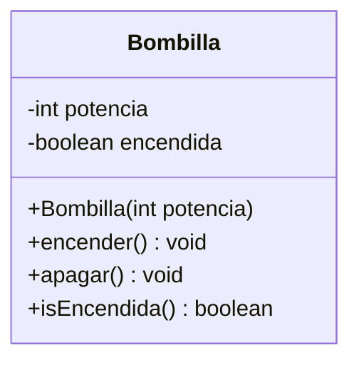
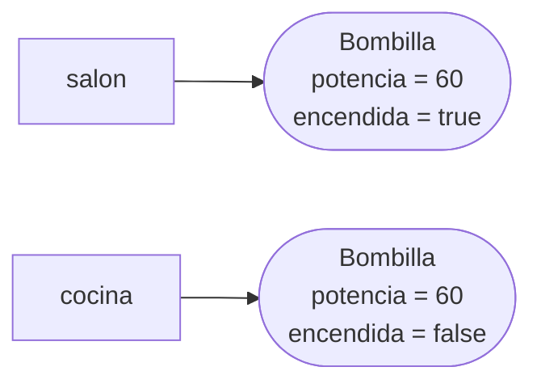
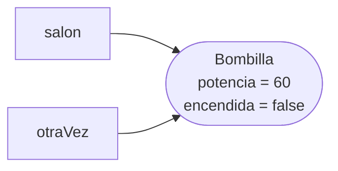

# 1. Clases y objetos

[Índice](README.md) · Siguiente: [2. Miembros de una clase →](02-miembros-de-una-clase.md)

---

## 1.1. Introducción

Un programa orientado a objetos es un conjunto de **objetos** que se crean, colaboran entre sí y dejan de existir cuando ya no son útiles.

Para crear esos objetos necesitamos **clases**. Una clase es un molde o plantilla: describe cómo serán los objetos, pero no es ningún objeto concreto.

- La **clase** existe en el código que escribimos.
- Los **objetos** existen mientras el programa se está ejecutando.

## 1.2. Objetos

Piensa en las bombillas de tu casa. Todas son "bombillas", pero cada una es distinta: la del salón puede estar encendida y la de la cocina apagada.

Todo objeto tiene tres características:

| Característica | Qué es | Ejemplo con una bombilla |
|---|---|---|
| **Estado** | Los valores de sus propiedades en un momento dado | `potencia = 60`, `encendida = true` |
| **Comportamiento** | Lo que sabe hacer: sus métodos | `encender()`, `apagar()` |
| **Identidad** | Cada objeto es único, aunque otro tenga los mismos valores | La bombilla del salón y la de la cocina son dos bombillas distintas |

> [!IMPORTANT]
> El estado no es algo distinto de las propiedades: es el **valor** que tienen en este momento. "Encendida" es el valor de la propiedad `encendida`.

Las propiedades se llaman **atributos** y las acciones, **métodos**. Al conjunto de atributos y métodos se le llama **miembros** del objeto.

Los objetos colaboran enviándose **mensajes**: enviar un mensaje a un objeto es pedirle que ejecute uno de sus métodos.

## 1.3. Clases

Una **clase** define qué atributos y qué métodos tendrán sus objetos. Su estructura básica es:

```java
public class NombreClase {
    // atributos
    // constructores
    // métodos
}
```

Por ejemplo, la clase `Bombilla` ([código completo](ejemplos/src/ut03/objetos/Bombilla.java)):

```java
public class Bombilla {

    private int potencia;       // atributos
    private boolean encendida;

    public Bombilla(int potencia) {   // constructor
        this.potencia = potencia;
    }

    public void encender() {          // métodos
        encendida = true;
    }

    public void apagar() {
        encendida = false;
    }

    public boolean isEncendida() {
        return encendida;
    }
}
```

> [!TIP]
> **Convenios de nombres en Java:** las clases empiezan por mayúscula (`Bombilla`, `CuentaBancaria`); los atributos, métodos y variables, por minúscula (`potencia`, `isEncendida`). Cada clase pública va en un fichero con su mismo nombre: `Bombilla.java`.

### Representación en UML

En los diagramas de clases UML, una clase se dibuja como una caja con tres zonas: nombre, atributos y métodos. El `-` indica `private` y el `+`, `public`.



## 1.4. Instanciación de objetos

**Instanciar** una clase es crear un objeto a partir de ella. Se hace con el operador `new`:

```java
Bombilla salon = new Bombilla(60);
```

En esta línea ocurren tres cosas:

1. **Declaración:** `Bombilla salon` crea una variable que podrá guardar una referencia a un objeto `Bombilla`.
2. **Creación:** `new` reserva memoria para un objeto nuevo y da a sus atributos los valores por defecto (`0`, `false` o `null`).
3. **Inicialización:** se ejecuta el constructor con los argumentos indicados (`60`) y `new` devuelve la referencia al objeto, que se guarda en `salon`.

Una vez creado, usamos el objeto con el **operador punto**:

```java
salon.encender();                         // enviamos un mensaje al objeto
System.out.println(salon.isEncendida());  // true
```

Podemos crear tantos objetos como queramos, y cada uno tiene su propio estado:

```java
Bombilla salon = new Bombilla(60);
Bombilla cocina = new Bombilla(60);

salon.encender();

System.out.println(salon.isEncendida());   // true
System.out.println(cocina.isEncendida());  // false: cocina no ha cambiado
```

## 1.5. Referencias

Una variable de tipo objeto **no contiene el objeto**, sino una **referencia** a él: la forma de encontrarlo en la memoria.



### `null`

`null` indica que una variable no referencia a ningún objeto.

```java
Bombilla b = null;      // no hay ninguna bombilla todavía
// b.encender();        // NullPointerException: no hay objeto al que enviar el mensaje
b = new Bombilla(40);
b.encender();           // ahora sí
```

> [!WARNING]
> Las **variables locales** no se inicializan solas: si declaras `Bombilla b;` y la usas sin asignarle nada, el programa no compila. En cambio, los **atributos** de tipo objeto valen `null` por defecto.

### Referencias compartidas

Si asignamos una variable a otra, **no se copia el objeto**: las dos variables pasan a referenciar el mismo objeto.

```java
Bombilla otraVez = salon;      // NO crea una bombilla nueva
otraVez.apagar();
System.out.println(salon.isEncendida());   // false: es el mismo objeto
```



### Comparar referencias con `==`

Con objetos, `==` comprueba si dos variables apuntan **al mismo objeto**, no si sus valores son iguales:

```java
System.out.println(salon == cocina);    // false: dos objetos distintos (identidad)
System.out.println(salon == otraVez);   // true: el mismo objeto
```

Para comparar el contenido de dos objetos se usa el método `equals`, que veremos en el [apartado 3](03-metodos-especiales.md#33-equals).

Puedes ejecutar todo este ejemplo en [`PruebaBombilla.java`](ejemplos/src/ut03/objetos/PruebaBombilla.java).

---

## Para practicar

1. Piensa en un objeto de tu entorno (un móvil, una lavadora, un semáforo…). Escribe tres atributos, tres métodos y un ejemplo de su estado.
2. Escribe una clase `Contador` con un atributo `valor` y los métodos `incrementar()`, `reiniciar()` y `getValor()`. Crea dos contadores, incrementa uno tres veces y el otro una vez, y muestra sus valores.
3. ¿Qué imprime este código? Razónalo antes de ejecutarlo.

   ```java
   Contador a = new Contador();
   Contador b = a;
   b.incrementar();
   System.out.println(a.getValor());
   ```

   <details>
   <summary>Solución del ejercicio 3</summary>

   Imprime `1`. `a` y `b` referencian el mismo objeto, así que incrementar a través de `b` cambia el contador que ve `a`.
   </details>

---

[Índice](README.md) · Siguiente: [2. Miembros de una clase →](02-miembros-de-una-clase.md)
