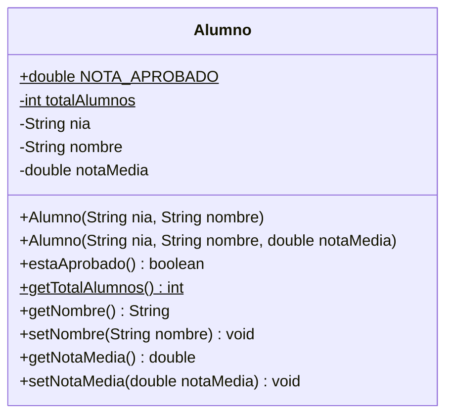

# 2. Miembros de una clase

[← 1. Clases y objetos](01-clases-y-objetos.md) · [Índice](README.md) · Siguiente: [3. Métodos especiales →](03-metodos-especiales.md)

---

En este apartado usaremos como ejemplo la clase [`Alumno`](ejemplos/src/ut03/miembros/Alumno.java):



En UML, los miembros **subrayados** (en Mermaid, con `$`) son estáticos. Los veremos en el apartado 2.7.

## 2.1. Atributos

Los atributos guardan la información de cada objeto. Se declaran dentro de la clase, fuera de los métodos:

```java
modificador tipo nombre;
```

```java
public class Alumno {
    private String nia;
    private String nombre;
    private double notaMedia;
}
```

Normalmente los atributos son `private`: solo se puede acceder a ellos desde dentro de la clase (lo veremos en el [apartado 3](03-metodos-especiales.md)).

Si no se inicializan, los atributos toman un **valor por defecto**:

| Tipo | Valor por defecto |
|---|---|
| `int`, `long`, `short`, `byte` | `0` |
| `double`, `float` | `0.0` |
| `boolean` | `false` |
| `char` | `'\u0000'` |
| Cualquier objeto (`String`, `Alumno`…) | `null` |

## 2.2. Métodos

Los métodos definen el comportamiento del objeto. Su sintaxis es:

```java
modificador tipoDevuelto nombreMetodo(parámetros) {
    // cuerpo del método
}
```

```java
public boolean estaAprobado() {
    return notaMedia >= NOTA_APROBADO;
}
```

Los métodos que se ejecutan sobre un objeto concreto se llaman **métodos de instancia**: para usarlos hay que tener un objeto creado.

### Cabecera y signatura

- La **cabecera** es la primera línea completa del método: modificadores, tipo devuelto, nombre y parámetros.
- La **signatura** es solo el **nombre** y los **tipos de los parámetros**, en orden.

```java
public double calcularMedia(int nota1, int nota2)
// Cabecera:  toda la línea
// Signatura: calcularMedia(int, int)
```

Ni el tipo devuelto, ni los modificadores, ni los nombres de los parámetros forman parte de la signatura. Por eso una clase no puede tener dos métodos que solo se diferencien en el tipo devuelto: al escribir `calcularMedia(5, 7)` el compilador no sabría cuál elegir.

### Parámetros y argumentos

- Los **parámetros** son las variables que aparecen en la definición del método.
- Los **argumentos** son los valores que se pasan al llamarlo.

```java
public void setNotaMedia(double notaMedia) { ... }   // notaMedia es un parámetro

alumno.setNotaMedia(7.5);                             // 7.5 es un argumento
```

Al llamar a un método hay que pasarle los argumentos en el **mismo número, tipo y orden** que sus parámetros.

### Valor devuelto

Si el método devuelve un valor, su cabecera indica el tipo y el cuerpo termina con `return valor;`. El valor devuelto se puede guardar, usar en una expresión o pasar a otro método:

```java
boolean aprobado = ana.estaAprobado();                  // se guarda
if (ana.getNotaMedia() > 9) { ... }                     // se usa en una expresión
System.out.println(ana.getNombre().toUpperCase());      // se usa directamente
```

Si no devuelve nada, el tipo es `void`. Puede usar `return;` sin valor para terminar antes:

```java
public void saludar(String nombre) {
    if (nombre == null) {
        return;              // termina el método
    }
    System.out.println("Hola, " + nombre);
}
```

## 2.3. Ámbito de las variables

El **ámbito** de una variable es la zona del código en la que existe y se puede usar.

| Tipo de variable | Dónde se declara | Dónde se puede usar | ¿Valor por defecto? |
|---|---|---|---|
| **Atributo** | En la clase, fuera de los métodos | En todos los métodos de la clase | Sí |
| **Parámetro** | En la cabecera del método | Solo dentro de ese método | Recibe el argumento |
| **Variable local** | Dentro de un método o bloque `{ }` | Solo dentro de ese método o bloque | No: hay que inicializarla |

```java
public void ejemplo() {
    int a = 1;            // local del método
    if (a > 0) {
        int b = 2;        // local del bloque if
        System.out.println(a + b);
    }
    // System.out.println(b);   // error: b ya no existe
}
```

> [!NOTE]
> Java no tiene variables globales. Lo más parecido son los atributos `static` (apartado 2.7).

## 2.4. Paso de parámetros

En Java el paso de parámetros es **siempre por valor**: el método recibe una **copia** del valor de la variable.

- Si la variable es de un **tipo primitivo**, el método recibe una copia del número, carácter o booleano. Lo que haga con ella no afecta a la variable original.
- Si la variable es de un **tipo objeto**, lo que se copia es la **referencia**. El método puede cambiar el **estado** del objeto original a través de ella, pero si asigna un objeto nuevo al parámetro, la variable original no cambia.

```java
static void duplicar(int numero) {
    numero = numero * 2;                  // cambia la copia
}

static void aprobar(Alumno alumno) {
    alumno.setNotaMedia(5);               // cambia el objeto original
}

static void cambiarAlumno(Alumno alumno) {
    alumno = new Alumno("9999", "Otro");  // solo cambia la copia de la referencia
}
```

```java
int n = 10;
duplicar(n);
System.out.println(n);                    // 10

Alumno marta = new Alumno("2001", "Marta", 3);
aprobar(marta);
System.out.println(marta.getNotaMedia()); // 5.0

cambiarAlumno(marta);
System.out.println(marta.getNombre());    // Marta
```

Código completo: [`PasoDeParametros.java`](ejemplos/src/ut03/miembros/PasoDeParametros.java).

> [!NOTE]
> Algunas clases, como `String`, son **inmutables**: sus métodos nunca modifican el objeto, sino que devuelven uno nuevo. Por eso `nombre.toUpperCase();` no cambia `nombre`; hay que guardar el resultado: `nombre = nombre.toUpperCase();`.

## 2.5. Constructores

Un **constructor** se ejecuta automáticamente al crear un objeto con `new`. Sirve para **inicializar** el objeto y dejarlo en un estado válido.

- Se llama **exactamente igual** que la clase.
- **No tiene tipo devuelto**, ni siquiera `void`.

```java
public Alumno(String nia, String nombre, double notaMedia) {
    this.nia = nia;
    this.nombre = nombre;
    this.notaMedia = notaMedia;
}
```

### Constructor por defecto

Si una clase no declara **ningún** constructor, el compilador añade uno sin parámetros, que deja los atributos con sus valores por defecto.

> [!IMPORTANT]
> En cuanto escribes un constructor cualquiera, el compilador **ya no añade** el constructor por defecto. Si también quieres crear objetos sin parámetros, tienes que escribirlo tú.

### La palabra `this`

`this` es una referencia al **objeto actual**: el objeto sobre el que se está ejecutando el constructor o el método.

- `this.nombre` es el atributo; `nombre`, a secas, es el parámetro que se llama igual.
- `this(...)`, escrito como **primera sentencia** de un constructor, llama a otro constructor de la misma clase. Así no se repite código:

```java
public Alumno(String nia, String nombre) {
    this(nia, nombre, 0.0);   // reutiliza el constructor de tres parámetros
}
```

## 2.6. Sobrecarga de métodos

La **sobrecarga** consiste en tener varios métodos o constructores con el **mismo nombre** pero **distinta signatura** (distinto número, tipo u orden de parámetros).

```java
Alumno luis = new Alumno("1002", "Luis");          // constructor de 2 parámetros
Alumno ana = new Alumno("1001", "Ana", 7.5);       // constructor de 3 parámetros
```

Java ya usa sobrecarga en muchas clases. Por ejemplo, `System.out.println` tiene una versión para `int`, otra para `double`, otra para `String`…

## 2.7. Miembros estáticos o de clase

Un miembro `static` pertenece a la **clase**, no a cada objeto. Hay una sola copia, compartida por todos los objetos, y existe aunque no se haya creado ninguno.

```java
public class Alumno {
    public static final double NOTA_APROBADO = 5.0;   // constante de clase
    private static int totalAlumnos = 0;               // atributo de clase

    private String nombre;                             // atributo de instancia

    public Alumno(...) {
        ...
        totalAlumnos++;                                // cuenta los alumnos creados
    }

    public static int getTotalAlumnos() {              // método de clase
        return totalAlumnos;
    }
}
```

Los miembros estáticos se usan con el **nombre de la clase**, sin crear objetos:

```java
System.out.println(Alumno.getTotalAlumnos());
System.out.println(Alumno.NOTA_APROBADO);
```

Restricciones de los métodos `static`:

- No pueden usar `this`, porque no hay objeto actual.
- No pueden acceder directamente a atributos ni métodos de instancia: necesitan una referencia a un objeto.

> [!TIP]
> **¿Debe ser `static`?** Pregúntate si el dato es de cada objeto o de la clase. El nombre de cada alumno no puede ser `static`: todos los alumnos tendrían el mismo. El número total de alumnos creados sí lo es.

Las clases de Java usan mucho los métodos estáticos: `Math.sqrt(16)`, `Integer.parseInt("12")`, `String.valueOf(3)`… Los verás en el [apartado 6](06-clases-de-uso-comun.md).

## 2.8. Paquetes

Un **paquete** agrupa clases relacionadas. Sirve para organizar el código, evitar conflictos de nombres y controlar el acceso.

- Por convenio, los nombres de paquete van en minúsculas y siguen el dominio invertido: `com.instituto.dam.modelo`.
- La primera sentencia del fichero indica su paquete con `package`.
- Para usar una clase de otro paquete hay que importarla con `import`.

```java
package ut03.miembros;

import java.util.HashSet;   // una clase concreta
import java.util.*;         // todas las clases del paquete

public class PruebaAlumno { ... }
```

Las clases de `java.lang` (`String`, `Math`, `System`, `Integer`…) se importan automáticamente.

> [!TIP]
> En Eclipse, **Ctrl+Mayús+O** añade los `import` que faltan y quita los que sobran.

### Librerías externas

Una **librería** es un conjunto de clases ya compiladas, normalmente en un fichero **JAR**. Para usar una librería externa:

- **En Eclipse:** copia el JAR en una carpeta `lib` del proyecto y, con clic derecho sobre él, elige *Build Path → Add to Build Path*.
- **Con Maven o Gradle:** se declara la dependencia y la herramienta descarga el JAR automáticamente.

Después, sus clases se importan con `import`, como las de Java.

---

## Para practicar

1. Escribe una clase `Rectangulo` con los atributos `base` y `altura`, dos constructores (uno sin parámetros, que cree un rectángulo de 1 × 1, y otro con base y altura) y los métodos `calcularArea()` y `calcularPerimetro()`. Usa `this(...)` en el constructor sin parámetros.
2. Añade a `Rectangulo` un atributo estático que cuente los rectángulos creados y un método estático para consultarlo.
3. Indica la signatura de cada método. ¿Pueden estar los tres en la misma clase?

   ```java
   public int sumar(int a, int b)
   public double sumar(int x, int y)
   public double sumar(double a, double b)
   ```

   <details>
   <summary>Solución del ejercicio 3</summary>

   Las signaturas son `sumar(int, int)`, `sumar(int, int)` y `sumar(double, double)`. Los dos primeros tienen la misma signatura (solo cambian el tipo devuelto y el nombre de los parámetros), así que **no** pueden estar en la misma clase. El primero y el tercero sí: es una sobrecarga.
   </details>

---

[← 1. Clases y objetos](01-clases-y-objetos.md) · [Índice](README.md) · Siguiente: [3. Métodos especiales →](03-metodos-especiales.md)
