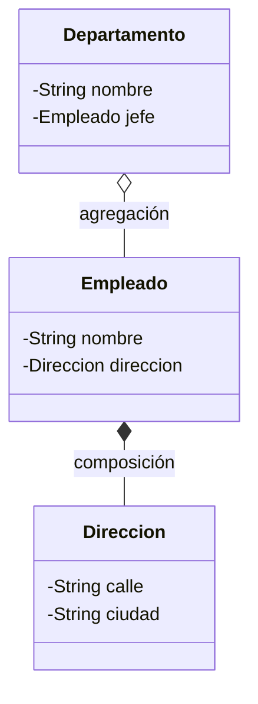
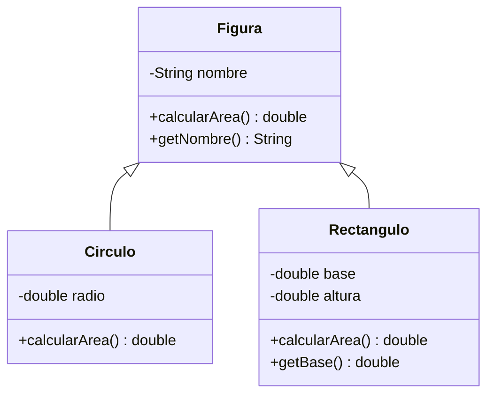
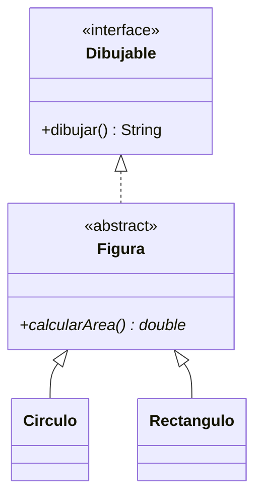

# 4. Relaciones entre clases (introducción)

[← 3. Métodos especiales](03-metodos-especiales.md) · [Índice](README.md) · Siguiente: [5. Modificadores y la clase `Object` →](05-modificadores-y-object.md)

---

> [!NOTE]
> Este apartado es una **primera toma de contacto**. La herencia, el polimorfismo, las clases abstractas y las interfaces se estudian en profundidad en unidades posteriores. Por ahora basta con que entiendas la idea y sepas reconocerlas en el código.

Las clases no viven aisladas: se relacionan entre sí. Las dos relaciones fundamentales son:

| Relación | Se lee… | Ejemplo | En Java |
|---|---|---|---|
| **Asociación** (composición o agregación) | «tiene un» | Un empleado **tiene una** dirección | Un atributo de otra clase |
| **Herencia** | «es un» | Un círculo **es una** figura | `extends` |

## 4.1. Composición y agregación

Una clase puede tener como atributos objetos de otras clases. El caso más sencillo ya lo conoces: una clase con atributos `String`.

La diferencia entre composición y agregación está en el **ciclo de vida** del objeto contenido:

| | Composición | Agregación |
|---|---|---|
| Idea | El objeto contenido **forma parte** del contenedor | El objeto contenido **existe por sí mismo** |
| ¿Quién lo crea? | El propio contenedor | Se recibe desde fuera |
| ¿Puede compartirse? | No | Sí |
| Si desaparece el contenedor… | desaparece con él | sigue existiendo |
| UML | Rombo **relleno** ◆ | Rombo **vacío** ◇ |



**Composición:** el empleado crea su propia dirección.

```java
public Empleado(String nombre, String calle, String ciudad) {
    this.nombre = nombre;
    this.direccion = new Direccion(calle, ciudad);   // la crea el empleado
}
```

**Agregación:** el departamento recibe un empleado que ya existe.

```java
public Departamento(String nombre, Empleado jefe) {
    this.nombre = nombre;
    this.jefe = jefe;                                 // se recibe ya creado
}
```

```java
Empleado eva = new Empleado("Eva", "C/ Mayor 3", "Valencia");
Departamento informatica = new Departamento("Informática", eva);
```

Si el departamento se elimina, Eva sigue trabajando en la empresa; su dirección, en cambio, no tiene sentido sin ella.

## 4.2. Herencia

La **herencia** permite crear una clase a partir de otra que ya existe. La nueva clase **hereda** sus atributos y métodos, y puede **añadir** otros nuevos o **redefinir** los heredados.

- **Superclase** (clase padre o base): la clase de la que se hereda.
- **Subclase** (clase hija o derivada): la clase que hereda.



En UML, la flecha va **de la subclase a la superclase** y termina en un triángulo hueco. En la subclase solo se dibuja lo que añade o redefine.

En Java se usa `extends`:

```java
public class Circulo extends Figura {

    private double radio;

    public Circulo(double radio) {
        super("Círculo");          // llama al constructor de Figura
        this.radio = radio;
    }

    @Override
    public double calcularArea() { // redefine el método heredado
        return Math.PI * radio * radio;
    }
}
```

Ideas básicas:

- En Java la herencia es **simple**: una clase solo puede extender **una** clase.
- `super(...)` llama a un constructor de la superclase. Debe ser la primera sentencia del constructor.
- Los **constructores no se heredan**.
- La subclase hereda los atributos `private` de la superclase, pero no puede acceder a ellos directamente: lo hace a través de los métodos públicos (`getNombre()`).
- Todas las clases de Java heredan, directa o indirectamente, de `Object` ([apartado 5](05-modificadores-y-object.md#52-la-clase-object)).

> [!TIP]
> Para saber si usar herencia, prueba la frase «**es un**»: un círculo *es una* figura (herencia); un empleado *tiene una* dirección (composición), pero no *es una* dirección.

## 4.3. Polimorfismo

Una variable del tipo de la **superclase** puede referenciar un objeto de cualquiera de sus **subclases**:

```java
Figura f1 = new Circulo(1);
Figura f2 = new Rectangulo(2, 3);
```

El **polimorfismo** consiste en que **el mismo mensaje** produce **comportamientos distintos** según la clase real del objeto que lo recibe:

```java
System.out.println(f1.calcularArea());   // 3.141592653589793 (versión de Circulo)
System.out.println(f2.calcularArea());   // 6.0               (versión de Rectangulo)
```

La llamada es la misma (`calcularArea()`), pero cada objeto ejecuta su propia versión.

### Compatibilidad de tipos

A través de una variable de tipo `Figura` solo se pueden usar los métodos declarados en `Figura`, aunque el objeto sea un `Rectangulo`:

```java
// f2.getBase();    // no compila: Figura no tiene getBase()
```

Para usarlos hay que convertir la referencia al tipo de la subclase (*casting*). Para hacerlo con seguridad, primero se comprueba el tipo con `instanceof`:

```java
if (f2 instanceof Rectangulo r) {        // comprueba y convierte a la vez
    System.out.println(r.getBase());     // 2.0
}
```

> [!WARNING]
> **Sobrecarga** y **sobrescritura** no son lo mismo:
> - **Sobrecarga** (*overload*): mismo nombre y distinta signatura, normalmente en la misma clase.
> - **Sobrescritura** (*override*): misma signatura en la subclase, para redefinir un método heredado. Se marca con `@Override`.

## 4.4. Clases abstractas

Una **clase abstracta** se declara con `abstract` y **no se puede instanciar**: solo sirve como base para otras clases.

Suele tener **métodos abstractos**: métodos declarados sin cuerpo que cada subclase debe implementar.

```java
public abstract class Figura {

    private String nombre;

    protected Figura(String nombre) {
        this.nombre = nombre;
    }

    public abstract double calcularArea();   // sin cuerpo: termina en ;

    public String getNombre() {
        return nombre;
    }
}
```

```java
// Figura f = new Figura("X");   // no compila: Figura es abstracta
Figura f = new Circulo(1);       // correcto
```

Tiene sentido que `Figura` sea abstracta: no existe una "figura" sin forma concreta, y no sabemos calcular su área hasta saber si es un círculo o un rectángulo.

Reglas básicas:

- Si una clase tiene algún método abstracto, la clase debe ser abstracta.
- Una clase abstracta puede tener atributos, constructores y métodos con código.
- Una subclase que no sea abstracta debe implementar **todos** los métodos abstractos heredados.

## 4.5. Interfaces

Una **interfaz** define un **contrato**: un conjunto de métodos que deben ofrecer las clases que la implementen. Se declara con `interface` y se implementa con `implements`.

```java
public interface Dibujable {
    String dibujar();   // implícitamente public y abstract
}
```

```java
public abstract class Figura implements Dibujable { ... }

public class Circulo extends Figura {
    @Override
    public String dibujar() {
        return "( )";
    }
}
```

```java
Dibujable d = new Rectangulo(2, 3);
System.out.println(d.dibujar());   // [ ]
```



Ideas básicas:

- Una clase solo puede extender una clase, pero puede **implementar varias interfaces**: `class A extends B implements I1, I2`.
- No se pueden crear objetos de una interfaz, pero sí variables de su tipo.
- Desde Java 8 una interfaz también puede tener métodos `default` y `static` con código. Lo veremos más adelante.

> [!TIP]
> **¿Clase abstracta o interfaz?** Para empezar: usa una clase abstracta cuando las subclases comparten datos y código (todas las figuras tienen nombre); usa una interfaz cuando solo quieres exigir que sepan hacer algo (dibujarse), aunque sean clases muy distintas.

Todo este apartado está en [`PruebaRelaciones.java`](ejemplos/src/ut03/relaciones/PruebaRelaciones.java), que muestra:

```
Eva, vive en C/ Mayor 3 (Valencia)
Departamento Informática (jefe: Eva)
Círculo de área 3,14
Rectángulo de área 6,00
Dibujo: [ ]
Base: 2.0
```

---

## Para practicar

1. Indica si cada relación es «es un» o «tiene un» y, en este caso, si es composición o agregación: *Coche–Rueda*, *Perro–Animal*, *Alumno–Grupo*, *Factura–LíneaFactura*, *Profesor–Persona*.
2. Añade a las figuras de los ejemplos una clase `Triangulo` (base y altura) que extienda de `Figura`. Crea una variable `Figura` con un triángulo y muestra su área.

   <details>
   <summary>Solución del ejercicio 1</summary>

   - *Coche–Rueda*: «tiene un»; composición (las ruedas forman parte del coche).
   - *Perro–Animal*: «es un»; herencia (`Perro extends Animal`).
   - *Alumno–Grupo*: «tiene un»; agregación (el alumno existe aunque el grupo desaparezca).
   - *Factura–LíneaFactura*: «tiene un»; composición (una línea no tiene sentido sin su factura).
   - *Profesor–Persona*: «es un»; herencia (`Profesor extends Persona`).
   </details>

---

[← 3. Métodos especiales](03-metodos-especiales.md) · [Índice](README.md) · Siguiente: [5. Modificadores y la clase `Object` →](05-modificadores-y-object.md)
