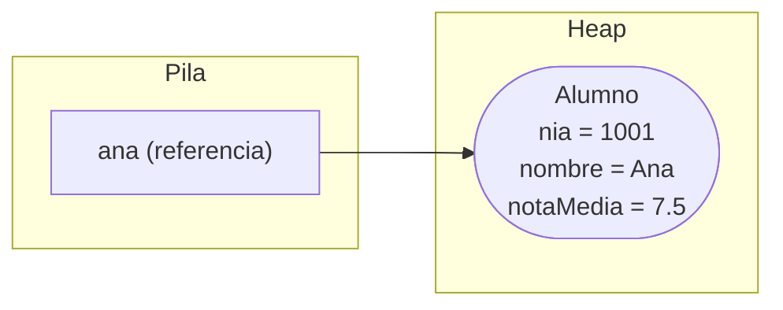

# 7. Memoria y entorno de desarrollo

[← 6. Clases de uso común](06-clases-de-uso-comun.md) · [Índice](README.md) · Siguiente: [8. Práctica →](08-practica.md)

---

## 7.1. Dónde viven los objetos

La máquina virtual de Java (JVM) organiza la memoria en varias zonas. Las dos que más nos interesan son:

| Zona | Qué guarda | ¿Cuántas hay? |
|---|---|---|
| **Pila** (*stack*) | Las variables locales y los parámetros de cada método en ejecución, incluidas las **referencias** a objetos | Una por cada hilo |
| **Montón** (*heap*) | Los **objetos** creados con `new` | Una para toda la JVM |

Además, la información de las clases (sus métodos y atributos estáticos) se guarda en el *Metaspace*.

```java
public static void main(String[] args) {
    Alumno ana = new Alumno("1001", "Ana", 7.5);
}
```



## 7.2. Destrucción de objetos: el *garbage collector*

En Java **no se destruyen los objetos a mano** (no existe una instrucción como el `delete` de C++). Un objeto puede eliminarse cuando ya **no es alcanzable**: cuando no queda ninguna referencia a él.

Situaciones habituales:

```java
new Alumno("1003", "Pablo");             // 1. no se guarda la referencia

Alumno a = new Alumno("1004", "Sara");
a = null;                                // 2. se asigna null a la variable

Alumno b = new Alumno("1005", "Íker");
b = new Alumno("1006", "Noa");           // 3. se asigna otro objeto: Íker queda sin referencias
```

4. Al terminar un método, sus variables locales desaparecen; los objetos que solo estaban referenciados por ellas quedan sin referencias.

El **recolector de basura** (*garbage collector*, GC) se ejecuta automáticamente, localiza en el *heap* los objetos que ya no son alcanzables y libera la memoria que ocupan.

- El programador **no decide** cuándo actúa.
- `System.gc()` solo **sugiere** a la JVM que lo ejecute, sin ninguna garantía.
- El método `finalize()` está obsoleto: no lo uses para liberar recursos.

> [!IMPORTANT]
> El GC libera **memoria**, pero no cierra ficheros ni conexiones. Esos recursos se cierran explícitamente con `close()`, preferiblemente con *try-with-resources*, que lo hace automáticamente. Lo usarás con los ficheros:
>
> ```java
> try (Scanner fichero = new Scanner(new File("datos.txt"))) {
>     // usar el fichero
> }   // aquí se llama automáticamente a fichero.close()
> ```

## 7.3. Crear, compilar y ejecutar una aplicación

Un programa Java pasa por tres fases:


Para desarrollar hace falta un **JDK** (*Java Development Kit*), que incluye el compilador `javac` y la JVM. Usa una versión **LTS** (de soporte a largo plazo), como Java 21 o Java 25.

### Desde la línea de comandos

```bash
javac Saludo.java     # compila: genera Saludo.class
java Saludo           # ejecuta la clase que contiene el main
java Saludo.java      # (Java 11+) compila en memoria y ejecuta
```

Si la clase está en un paquete, se compila desde la carpeta raíz del código y se ejecuta con su nombre completo:

```bash
javac -d bin src/ut03/objetos/*.java
java -cp bin ut03.objetos.PruebaBombilla
```

### Con Eclipse

Un **IDE** (entorno de desarrollo integrado) como Eclipse, IntelliJ IDEA, NetBeans o VS Code reúne el editor, el compilador, la ejecución y el depurador.

1. **Crear el proyecto:** *File → New → Java Project*. Indica el nombre y el JDK. Si te ofrece crear `module-info.java`, en estos ejercicios no lo crees.
2. **Crear el paquete:** clic derecho sobre `src` → *New → Package* (por ejemplo, `ut03.objetos`).
3. **Crear una clase:** clic derecho sobre el paquete → *New → Class*. Para la clase principal, marca `public static void main(String[] args)`.
4. **Compilar:** Eclipse compila al guardar (*Project → Build Automatically*). Los errores aparecen subrayados en rojo y en la vista *Problems*; los avisos, en amarillo.
5. **Ejecutar:** con la clase del `main` abierta, *Run → Run As → Java Application* (**Ctrl+F11**). La salida y el teclado se usan en la vista *Console*.
6. **Depurar:** haz doble clic en el margen izquierdo para poner un punto de ruptura y ejecuta con *Run → Debug As → Java Application* (**F11**). Con **F6** avanzas línea a línea, con **F5** entras en los métodos y en la vista *Variables* ves el estado de los objetos.

> [!TIP]
> **Atajos de Eclipse muy útiles en esta unidad:**
>
> | Atajo | Para |
> |---|---|
> | **Ctrl+Espacio** | Ver los métodos disponibles de un objeto |
> | **Ctrl+Mayús+O** | Organizar los `import` |
> | **Ctrl+Mayús+F** | Formatear el código |
> | **Alt+Mayús+S** | Menú *Source*: generar constructores, *getters*, *setters*, `toString`, `equals`/`hashCode` |
> | **Ctrl+clic** sobre una clase | Abrir su código o su documentación |

---

## Para practicar

1. Crea en Eclipse un proyecto `UT03`, con un paquete `ut03.practicas`, y copia la clase `Bombilla`. Ejecuta `PruebaBombilla` en modo depuración, poniendo un punto de ruptura en `salon.encender()`, y observa en la vista *Variables* cómo cambia el atributo `encendida`.
2. Compila y ejecuta `PruebaBombilla` desde la línea de comandos.
3. ¿Cuántos objetos `Alumno` pueden eliminarse al llegar al comentario?

   ```java
   Alumno x = new Alumno("1", "Uno");
   Alumno y = new Alumno("2", "Dos");
   Alumno z = x;
   x = y;
   y = null;
   // ¿aquí?
   ```

   <details>
   <summary>Solución del ejercicio 3</summary>

   **Ninguno.** "Uno" sigue referenciado por `z`, y "Dos" por `x`. `y = null` solo quita una de las dos referencias a "Dos".
   </details>

---

[← 6. Clases de uso común](06-clases-de-uso-comun.md) · [Índice](README.md) · Siguiente: [8. Práctica →](08-practica.md)
