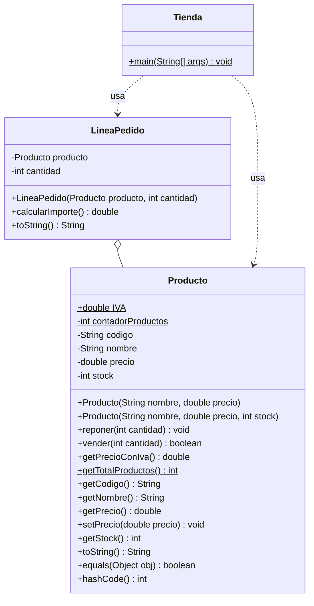

# 8. Práctica: tienda online

[← 7. Memoria y entorno de desarrollo](07-memoria-y-entorno.md) · [Índice](README.md) · Siguiente: [9. Autoevaluación →](09-autoevaluacion.md)

---

Vas a programar las primeras clases de una tienda online: los **productos** y las **líneas de pedido**, y un programa principal que las use.

**Contenidos que pones en práctica:** clases y objetos, constructores, `this`, sobrecarga, miembros estáticos, constantes, *getters* y *setters* con validación, `toString`, `equals`, `hashCode`, `String.format`, `Math.round`, `Scanner` y una relación de agregación.

## Diseño



Crea las tres clases en el paquete `ut03.practica`.

## Fase 1. Clase `Producto`

**Atributos**

- `IVA`: constante pública y estática con el valor `0.21`.
- `contadorProductos`: atributo privado y estático que cuenta los productos creados.
- `codigo`: se genera automáticamente al crear el producto, con el formato `P001`, `P002`, `P003`… No puede cambiar. *Pista:* `String.format("P%03d", numero)`.
- `nombre`, `precio` (sin IVA) y `stock` (unidades disponibles).

**Constructores**

- `Producto(String nombre, double precio, int stock)`.
- `Producto(String nombre, double precio)`: crea el producto con stock 0. Debe llamar al otro constructor con `this(...)`.

Los constructores deben rechazar, lanzando `IllegalArgumentException`, un nombre vacío o `null`, un precio menor o igual que 0 y un stock negativo.

## Fase 2. Comportamiento de `Producto`

- `reponer(int cantidad)`: suma unidades al stock. La cantidad debe ser positiva.
- `vender(int cantidad)`: si hay stock suficiente, lo resta y devuelve `true`; si no, no cambia nada y devuelve `false`. La cantidad debe ser positiva.
- `getPrecioConIva()`: devuelve el precio con IVA **redondeado a dos decimales**. *Pista:* `Math.round(valor * 100) / 100.0`.
- `getTotalProductos()`: método **estático** que devuelve cuántos productos se han creado.
- *Getters* de todos los atributos y **solo** un *setter*: `setPrecio`, que valida el precio. El stock únicamente cambia con `reponer` y `vender`.
- `toString()` con este formato (usa `String.format`):

  ```
  P001 - Ratón inalámbrico: 15,50 € (18,76 € con IVA), stock 10
  ```

- `equals()` y `hashCode()`: dos productos son iguales si tienen el **mismo nombre**, sin distinguir mayúsculas de minúsculas. *Cuidado:* `hashCode` debe ser coherente con esa regla.

## Fase 3. Clase `LineaPedido`

Una línea de pedido guarda un producto **ya existente** (agregación) y la cantidad comprada.

- Constructor `LineaPedido(Producto producto, int cantidad)`: el producto no puede ser `null` y la cantidad debe ser positiva.
- `calcularImporte()`: precio con IVA del producto × cantidad.
- `toString()`, con este formato:

  ```
  4 x Ratón inalámbrico = 75,04 €
  ```

## Fase 4. Programa principal `Tienda`

En el `main`:

1. Crea un producto «Ratón inalámbrico» de 15,50 € con 10 unidades, y un «Teclado» de 24,99 € **sin stock**. Repón 5 teclados. Muestra los dos productos.
2. Pide por teclado el nombre, el precio y el stock de un producto nuevo, créalo y muéstralo. Si el usuario escribe algo que no es un número, vuelve a pedírselo.
3. Pregunta cuántas unidades de ratón se quieren comprar. Si hay stock, crea una `LineaPedido` y muéstrala; si no, indica cuántas unidades quedan.
4. Muestra cuántos productos se han creado (usando el método estático).
5. Crea un producto «TECLADO» y comprueba con `equals` que es igual al «Teclado» anterior.

*Consejo:* escribe un método privado y estático `leerEntero(Scanner sc, String mensaje)` (y otro `leerDouble`) para no repetir el código de lectura con validación.

### Ejemplo de ejecución

```
P001 - Ratón inalámbrico: 15,50 € (18,76 € con IVA), stock 10
P002 - Teclado: 24,99 € (30,24 € con IVA), stock 5
Nombre del producto: Monitor 24"
Precio sin IVA: diez
Escribe un número (con coma decimal): 129,90
Stock inicial: 3
Creado: P003 - Monitor 24": 129,90 € (157,18 € con IVA), stock 3
Unidades de Ratón inalámbrico que compras: 4
4 x Ratón inalámbrico = 75,04 €
Productos creados: 3
¿teclado igual a TECLADO? true
```

## Fase 5 (ampliación opcional)

- Añade a `Producto` un método `aplicarDescuento(double porcentaje)` que rebaje el precio. El porcentaje debe estar entre 0 y 50.
- Crea una clase `Pedido` que tenga **tres** líneas de pedido como atributos (sin arrays todavía) y un método `calcularTotal()`.

## Entrega

- Sube el proyecto a tu repositorio de GitHub de la asignatura, en una carpeta `UT03-practica`.
- Haz **al menos un *commit* por fase**, con un mensaje que explique qué has hecho (por ejemplo, `Fase 2: vender y reponer con validación`).
- Documenta con **Javadoc** la clase, los constructores y los métodos públicos (`@param`, `@return`, `@throws`).
- El código debe compilar sin errores ni avisos.

## Rúbrica

| Criterio | Puntos |
|---|---:|
| Atributos con la visibilidad correcta, constante `IVA` y contador estático | 1 |
| Constructores sobrecargados, uso de `this(...)` y validación de datos | 1,5 |
| Código autogenerado con el formato `P001` | 0,5 |
| `reponer` y `vender` correctos (el stock nunca es negativo) | 1,5 |
| `getPrecioConIva` redondeado y *getters*/*setter* adecuados | 1 |
| `toString`, `equals` y `hashCode` coherentes entre sí | 1,5 |
| Clase `LineaPedido` (agregación, validación e importe) | 1 |
| Programa principal: lectura con `Scanner` y validación de la entrada | 1 |
| Javadoc, nombres, formato del código y *commits* por fase | 1 |
| **Total** | **10** |

La fase 5 puede sumar hasta 1 punto extra.

---

[← 7. Memoria y entorno de desarrollo](07-memoria-y-entorno.md) · [Índice](README.md) · Siguiente: [9. Autoevaluación →](09-autoevaluacion.md)
